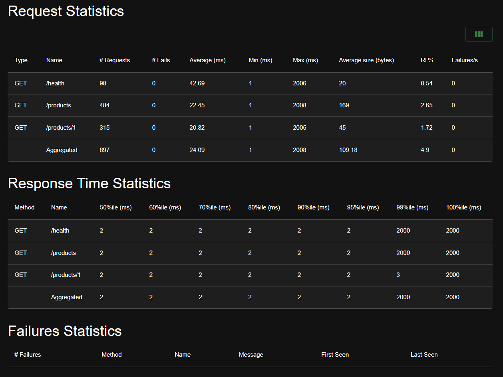
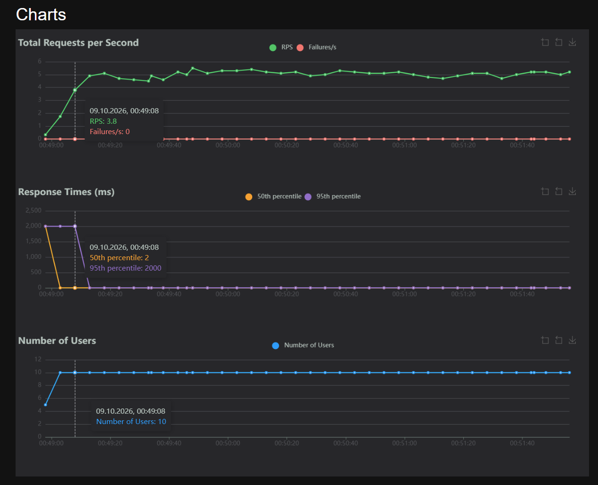
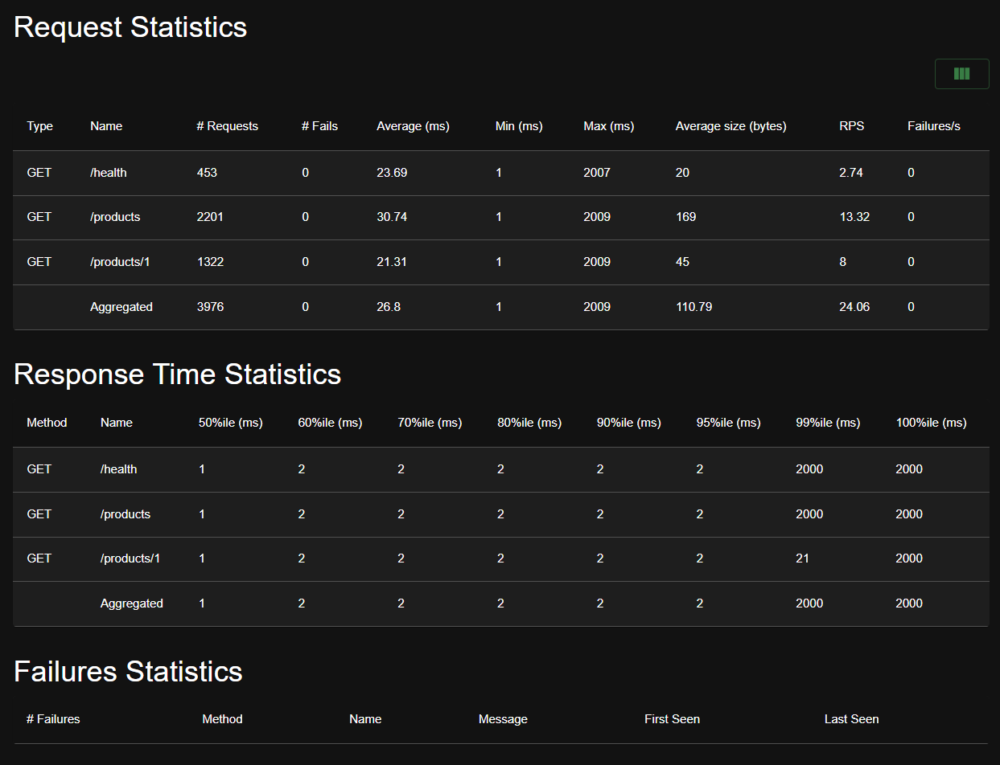
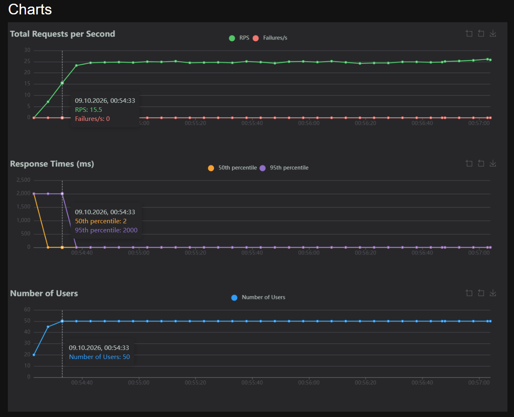
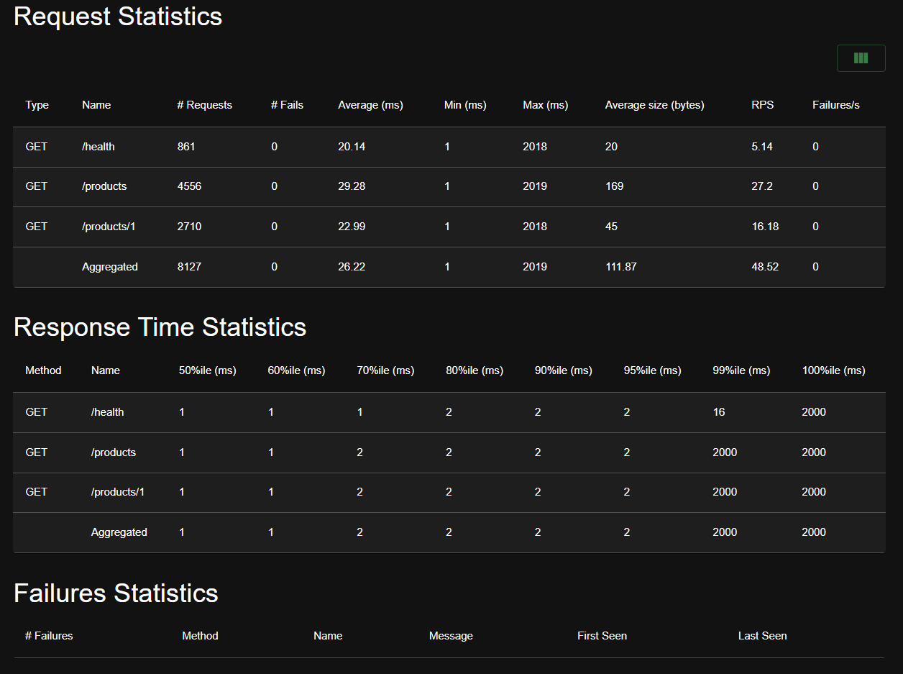
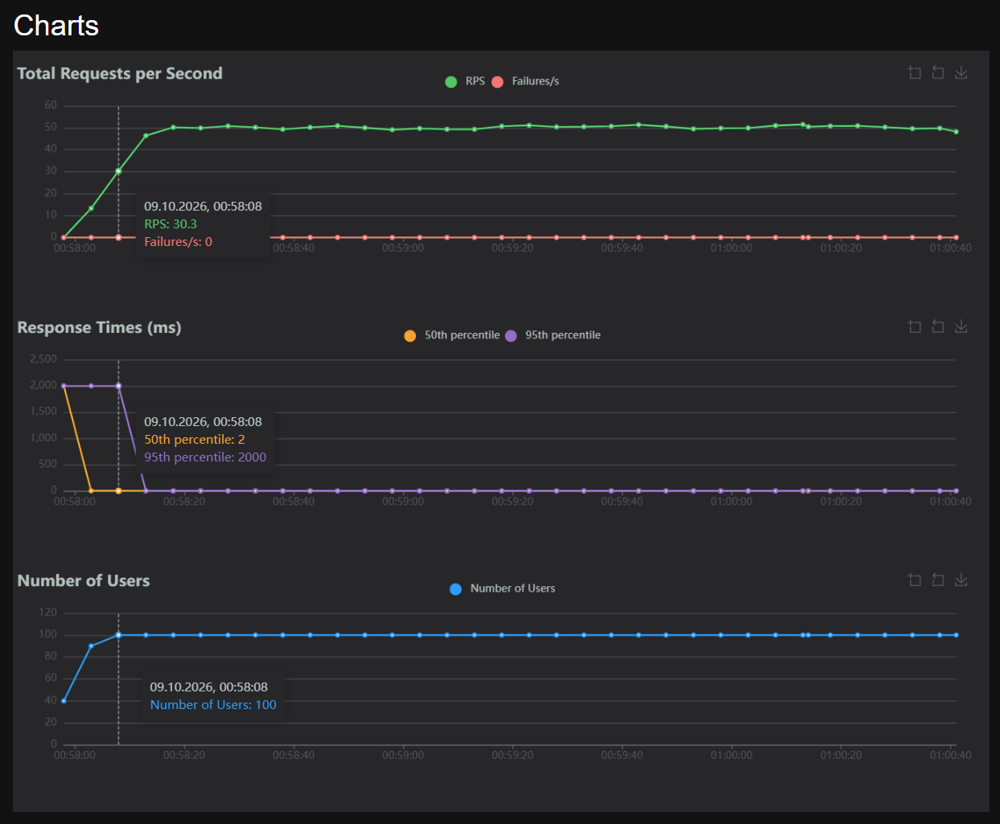

# 4.3. Интерпретируйте результаты:

1. **Какой RPS у сервиса при 10 пользователях?** Средний 4.9, пиковый 5.5
2. **При каком количестве пользователей latency начинает деградировать?** *Это точка, после которой система приближается к saturation.*
3. **Какая метрика деградирует первой: p50, p95 или p99?** *Обычно p99 растёт первым, потому что «хвостовые» запросы страдают от конкуренции за ресурсы.*
4. **Есть ли ошибки?** Нет

# 5. Формирование отчёта

1. **Описание сервиса:** 
Какие эндпоинты реализованы:

| Метод | Эндпоинт | Описание |
| :--- | :--- | :--- |
| `GET` | `/` | Возвращает общую информацию о сервисе: статус и текущее время. |
| `GET` | `/health` | Проверяет доступность и базовое состояние сервиса (health check). |
| `GET` | `/products` | Возвращает список всех доступных товаров. |
| `GET` | `/products/{product_id}` | Возвращает детальную информацию о конкретном товаре по его ID. |

Какие технологии использованы:
Python, FastAPI, Locust, Uvicorn

2. **Параметры тестов:** 

3. **Результаты:**

| Тест | Users | Spawn Rate | RPS | p50 | p95 | p99 | Error rate | Duration |
| :--- | :---: | :---: | :---: | :---: | :---: | :---: | :---: | :---: |
| A | 10 | 1 | 4.9 | 2 | 2 | 2000 | 0 | 3.02 |
| B | 50 | 5 | 24.6 | 1 | 2 | 2000 | 0 | 2.45 |
| C | 100 | 10 | 48.52 | 1 | 2 | 2000 | 0 | 2.47 |

4. **Графики:**
**Тест A**

**Тест B**

**Тест C**

5. **Анализ:** *где находится точка saturation, какие метрики деградировали первыми, какие выводы можно сделать.*
6. **Ссылка на репозиторий:**
https://github.com/ggsw4/-Designing-data-intensive-services 