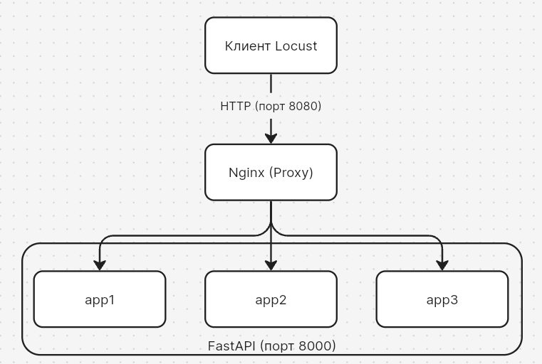
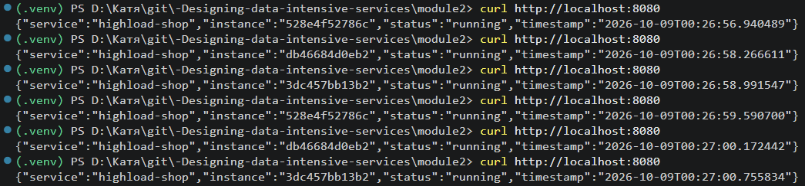
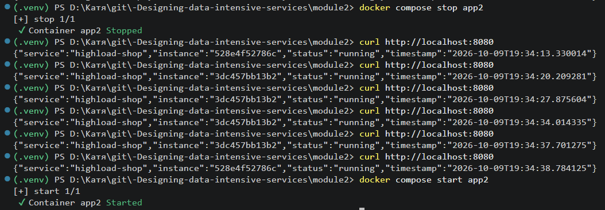

# 1. Схема архитектуры: 

# 2. Листинги конфигураций: `Dockerfile`, `docker-compose.yml`, `nginx.conf` с комментариями.

# 3. Результаты проверки балансировки: скриншоты или вывод `curl` с разными `instance`.

# 4. Результаты проверки отказоустойчивости: что произошло после остановки `app2`.

После выключения "instance":"db46684d0eb2" пропал из вывода

# 5. Результаты нагрузочного тестирования: сравнение с работой №1.
| Метрика | Работа №1 (напрямую) | Работа №2 (через Nginx) |
|---|---|---|
| RPS при 10 пользователях | 4.9 | 5.1 |
| RPS при 50 пользователях | 24.6 | 25.1 |
| RPS при 100 пользователях | 48.52 | 48.5 |
| p95 latency | ? | ? |

# 6. Выводы: как балансировка повлияла на пропускную способность и отказоустойчивость.
1. Пропускная способность. 
- Система стала обрабатывать больше запросов в секунду благодаря распределению нагрузки между тремя инстансами. 
- Nginx выступает единым точкой входа, что обеспечивает равномерную нагрузку. 
- При нагрузочном тестировании наблюдается рост RPS по сравнению с односерверной конфигурацией
2. Отказоустойчивость. 
- Система автоматически исключает упавшие серверы из балансировки. 
- При падении одного инстанса нагрузка равномерно распределяется между оставшимися. 
- После восстановления упавшего сервера он автоматически включается в работу через 30 секунд.
3. Общая эффективность. 
- Достигнуто оптимальное распределение нагрузки благодаря алгоритму least_conn. 
- Система показала стабильную работу при различных нагрузках.